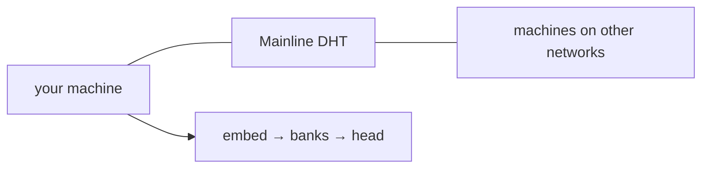

# nodo

**This repository is in test.** The protocol, the store, and the mesh are unfinished. Do not run this as production. Everyone can help the system and this repository move forward. Everyone who contributes gets credit.

# The model lives on the machines. Not in one place.

`nodo` is one process you run anywhere. A laptop in one city. A box in another. A rack on another continent. They find each other on the public BitTorrent Mainline DHT. Each disk keeps the part it created. A prompt walks the machines that are up.

```text
embed → every accepted bank → head
```

Weights do not travel. Banks grow on the disk that applied the carry. The next machine that joins adds a bank, not a copy of the model.

Protocol `nodo/1`. Command `nodo`. Created by [Luiz Eduardo](https://github.com/LuizEduPP).



## Run

Python `>= 3.14`. `cryptography`, `numpy`.

```text
pip install .
nodo
```

One command writes the store, takes the lock, and listens on TCP and UDP **9400**. A TTY shows `>`. Each line is a generation request.

One machine alone prints `no model`. Two accepted sites, different ids, open embed and head. Every site after that lengthens the walk.

Store: `$XDG_DATA_HOME/nodo`, `%LOCALAPPDATA%/nodo`, or `~/.local/share/nodo`.

## Docs

- [Overview](docs/index.md)
- [Flow](docs/flow.md)
- [Network](docs/network.md)
- [Model](docs/model.md)
- [Session](docs/session.md)
- [Protocol](docs/protocol.md)

## Contribute

Everyone can contribute. Code, docs, issues, reviews, and machines on other networks all count. Git keeps your name on the commits. The [contributors](https://github.com/LuizEduPP/nodo/graphs/contributors) list names everyone who landed work.

[Issues](https://github.com/LuizEduPP/nodo/issues) · [Pull requests](https://github.com/LuizEduPP/nodo/pulls)

[Luiz Eduardo](https://github.com/LuizEduPP) started the repository. Contributors keep their own credit.

## License

MIT. Copy it, run it, fork it. Keep the copyright notice. See [LICENSE](LICENSE).

Copyright © 2026 [Luiz Eduardo](https://github.com/LuizEduPP) · [LuizEduPP/nodo](https://github.com/LuizEduPP/nodo)
