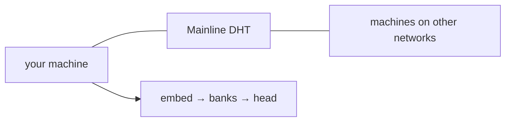

# nodo


**We are still developing this.** The repository is in test. The protocol, the store, and the mesh are unfinished. A prompt is not a usable model yet. Do not run this as production. Everyone can help the system and this repository move forward. Everyone who contributes gets credit.

# The model lives on the machines. Not in one place.

`nodo` is one process you run anywhere. A laptop in one city. A box in another. A rack on another continent. They find each other on the public BitTorrent Mainline DHT. Each disk keeps the part it created. A prompt walks the machines that are up.

```text
embed → every accepted bank → head
```

Weights do not travel. Banks grow on the disk that applied the carry. The next machine that joins adds a bank, not a copy of the model.

Protocol `nodo/1`. Command `nodo`. Created by [Luiz Eduardo](https://github.com/LuizEduPP).



## Run

Python `>= 3.14`. `cryptography`, `numpy`.

```text
pip install .
nodo
```

One command writes the store, takes the lock, and listens on TCP and UDP **9400**. A TTY shows `>`. Each line is a generation request.

One machine alone prints `no model`. Two accepted sites, different ids, open embed and head. Every site after that lengthens the walk.

Store: `$XDG_DATA_HOME/nodo`, `%LOCALAPPDATA%/nodo`, or `~/.local/share/nodo`.

## Status

We are still developing this. Checked items are in the tree. Unchecked items are the main line. Until those land, nodo is not fully usable.

### Done

- [x] `nodo` / `join()`: store, Ed25519, X25519, lock, prompt
- [x] One bank per machine, weights stay on that disk
- [x] Offer, capability, compose: embed on min id, head on max id, banks in between
- [x] Frame `nodo/1`, presence, association, records
- [x] Public Mainline DHT (`sha1(nodo/1)`), TCP/UDP **9400**, replica, `convey`
- [x] Session walk: `step-in` → carry → `step-out`
- [x] Docs, MIT, public repo, anyone can contribute and keep credit

### Next

- [ ] Reach the peer behind NAT/CGNAT. Wire is IPv4 only, TCP/UDP **9400**. Two NATs with no reachable hop do not associate. `convey` needs a route that already exists. `compose.yaml` still needs the host port open.
- [ ] Two real nodes on one host. A second `nodo` on the same store is a mailbox, not a participant. Local test needs two stores.
- [ ] A model that is not random. `embed`/`head` are `rng` from the id. Vocab is 256 bytes, untrained. EOS is token `0`. Text is junk, `incomplete`, or a full `bound`.
- [ ] Say why it failed. Empty request, missing association, missing file, `len(prompt) + bound > span`, and a dead `apply` all collapse to `no model` or a silent hang. `_apply_step` does not send `role-need`.
- [ ] Python people can run. Today `>= 3.14`. Occupied 9400 or DHT UDP down stays quiet; the process looks alive and has no mesh.
- [ ] Survive a restart. `peers` keeps `host:port`. Associations, offers, and the view die with the process.
- [ ] Tests. There are none in the tree.

## Docs

- [Overview](docs/index.md)
- [Flow](docs/flow.md)
- [Network](docs/network.md)
- [Model](docs/model.md)
- [Session](docs/session.md)
- [Protocol](docs/protocol.md)

## Contribute

Everyone can contribute. Code, docs, issues, reviews, and machines on other networks all count. Git keeps your name on the commits. The [contributors](https://github.com/LuizEduPP/nodo/graphs/contributors) list names everyone who landed work.

[Issues](https://github.com/LuizEduPP/nodo/issues) · [Discussions](https://github.com/LuizEduPP/nodo/discussions) · [Pull requests](https://github.com/LuizEduPP/nodo/pulls)

[Luiz Eduardo](https://github.com/LuizEduPP) started the repository. Contributors keep their own credit.

## Security

Do not open a public issue for a vulnerability. See [SECURITY.md](SECURITY.md).

## License

MIT. Copy it, run it, fork it. Keep the copyright notice. See [LICENSE](LICENSE).

Copyright © 2026 [Luiz Eduardo](https://github.com/LuizEduPP) · [LuizEduPP/nodo](https://github.com/LuizEduPP/nodo)
