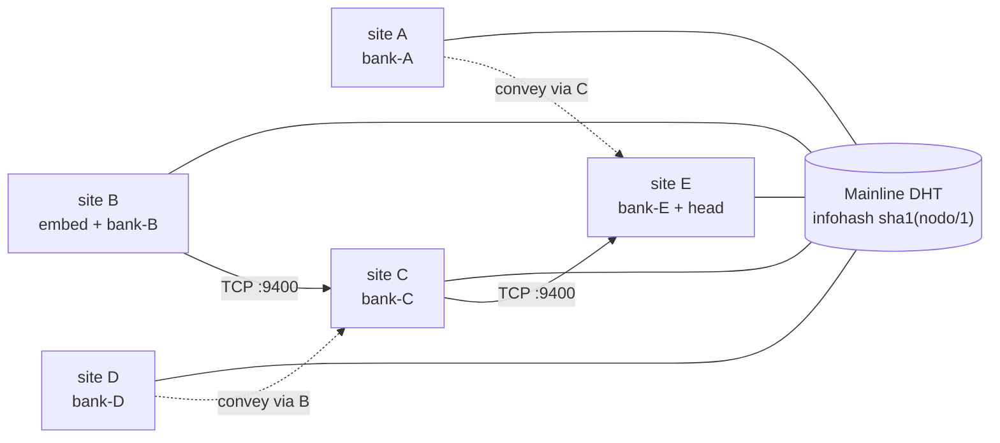
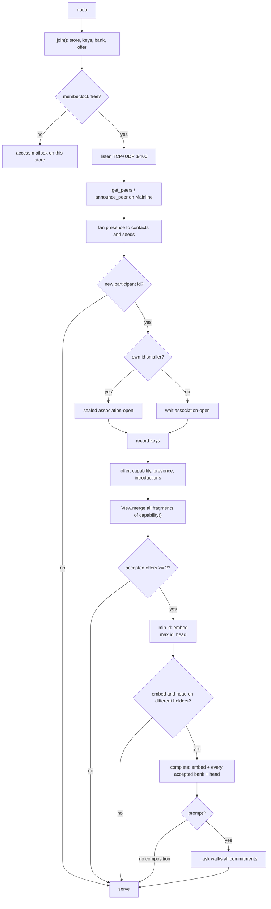
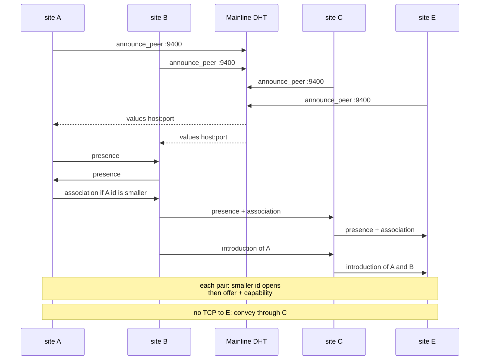
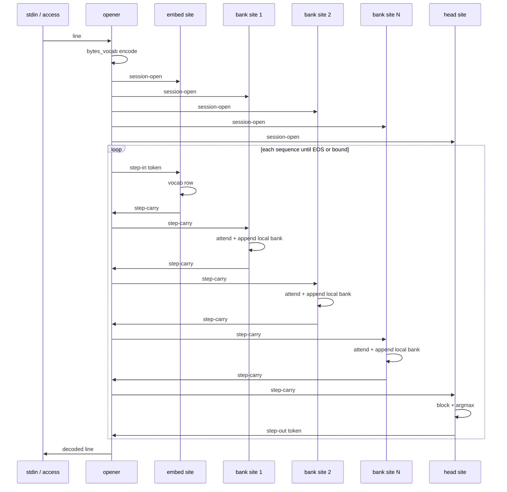

[nodo](index.md) · **Flow** · [Network](network.md) · [Model](model.md) · [Session](session.md) · [Protocol](protocol.md)

# Flow

nodo is one worldwide mesh. There is no site list and no machine cap. Each `nodo` on a different network announces `sha1(nodo/1)` on public Mainline DHT, associates with ids it hears, and keeps its own `bank-<hex>` on that disk. A prompt uses every accepted bank that is reachable in the current composition.

The diagrams below use five sites only as a drawing. The same path holds for tens or hundreds: more accepted offers means more banks in the walk, still one embed (smallest id) and one head (largest id), never both on the same disk.

## Topology

Solid lines are a stored TCP route. Dashed lines are `convey`: the body is a full `nodo/1` frame, forwarded by an associate that already has a route to the subject. Replica files (`$XDG_RUNTIME_DIR`) are same-host only; they are not the world path.

`introduction` floods known subjects after every new association. A machine that never had a direct path still learns boxes and can handshake through a hop.

TCP `:9400` must be reachable from somewhere for a route to form. Two NATs with no reachable hop cannot associate. A site that is reachable (or that already associated with a reachable hop) is enough for the others to convey.

## Lifetime of one site

Every machine runs this. Discovery is not “find the other one”; it is “hear any number of ids, associate with each”.

`no model` is only the case with fewer than two accepted holders, or embed and head still on the same id. One more reachable machine anywhere is enough to open embed and head. Each further machine adds a bank, not a second embed.

## How sites meet

Pairwise initiation is always the smaller Ed25519 id. Mesh growth is introductions plus convey, not a star and not a configured peer list. `peers` on disk is only what DHT already returned.

## Generation across the mesh

The opener is whichever complete site read the prompt. It does not collect weights. It sends `session-open` to every holder, then one token at a time: embed → banks in holder-id order → head.

Each bank apply appends the carry on **that** disk only. Machines in different countries therefore accumulate different memory. The next prompt attends against whatever each site already stored. If a site is down, `View.merge` drops its bank (holder not accepted) and compose may reassign; the opener suspends with `recomposition-incomplete` until the composition is complete again.

A hop with no TCP uses the same `step-*` items inside `convey`. The opener still needs an association to every holder (`_ask` returns `no model` if a remote holder has no assoc).

[nodo](index.md) · **Flow** · [Network](network.md) · [Model](model.md) · [Session](session.md) · [Protocol](protocol.md)
