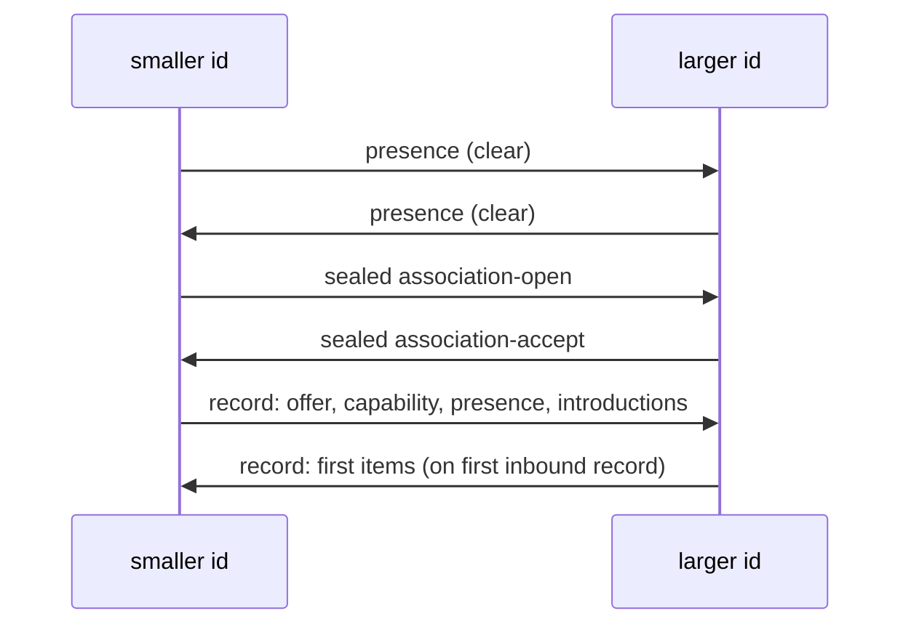

[nodo](index.md) · [Flow](flow.md) · **Network** · [Model](model.md) · [Session](session.md) · [Protocol](protocol.md)

# Network

Every byte that travels on the mesh is a **frame**: the six-byte prefix `nodo/1` followed by a body. `frame.complete` rejects anything shorter than seven bytes or without that prefix. `unwrap` returns the body; `wrap` prefixes it.

`network()` is `sha256(nodo/1)` (32 bytes). That digest names the replica directory on one host. It is not a participant id. Participant id is the 32-byte Ed25519 public key. Every `nodo` in the world that speaks `nodo/1` is the same mesh: same infohash, same capability id.

The intended deployment is many machines on many networks. Same-host replica is only a shortcut when two processes share a kernel. Worldwide meeting is Mainline DHT plus TCP `:9400` plus `convey` when there is no direct route.

## Delivery

`Participant._place_id` sends a frame to a subject. Preference, highest rank first (`_path_rank`):

1. **In-process replica** — another `Placement` with the same `network()` id, registered in `table.TABLE`.
2. **Same-host token** — `$XDG_RUNTIME_DIR/nodo/<network hex>/<token>` (or `%LOCALAPPDATA%`). The receiver's port is in `<token>.listen`; the last frame is copied to `<token>.put`.
3. **TCP** — IPv4, `SO_REUSEADDR`, bind `""` (all interfaces), default port `LISTEN=9400`.
4. **convey** — if there is no direct route, wrap the frame in a `convey` record and send it to an associated hop that already knows the subject.

Loopback and the process's own listen address are not stored as worldwide peers.

## Replica (same host)

On start, `Placement` creates:

```text
$XDG_RUNTIME_DIR/nodo/<sha256(nodo/1) hex>/
    identity          # must equal network()
    <token>           # this process
    <token>.put       # last outbound frame
    <token>.listen    # decimal TCP port, if listening
```

`TABLE.put` copies a notice to every other replica of the same `network()` and writes `<token>.put`. Other processes on the host that are not in the same Python process pick the frame up from `.put` / localhost TCP.

## TCP and the serve loop

`Placement._bind_world` listens. Incoming connections accumulate a bytearray until `frame.complete` succeeds. `Participant.serve` `select`s the listen socket, DHT UDP socket, accepted connections, and (on a TTY) stdin. Idle timeout is `NOTICE_WAIT` (1 second). That same interval retransmits unanswered `association-open` and re-emits presence while the mesh is still forming.

If bind of 9400 fails and no explicit port was requested, the process continues without a world socket (replica-only). An explicit `listen` that fails raises `PlacementError`.

## DHT

Public discovery is BitTorrent Mainline: KRPC, bencode, UDP on the same port as TCP. That network is already global. nodo does not run a private tracker or a bootstrap list of members. Doors are only the first hop into Mainline; after that, `get_peers` walks whatever nodes answer for `HASH`.

| constant | value |
| --- | --- |
| infohash | `sha1(nodo/1)` (`domain.HASH`) |
| node id | 20 random bytes per process |
| `ALPHA` | 3 outstanding `get_peers` at a time |
| `K` | 8 compact nodes / values |
| doors | `dht.libtorrent.org:25401`, `dht.transmissionbt.com:6881` |

Queries used:

- `get_peers` with `info_hash = HASH`. Replies collect `token`, compact `nodes`, and `values`.
- `announce_peer` with that token, `port` = TCP listen, `implied_port = 1`.
- `find_node` and `ping` are answered if asked.

A reply `ip` field (4 or 6 bytes) is treated as this process's public address and is excluded from the peer set. Fresh `values` that pass `_worldwide` (not loopback, not self) are appended to `peers` on disk.

Presence frames that arrive on the DHT UDP socket (a body that `frame.complete` accepts) are admitted as heard frames, not as KRPC.

The mesh then fans the last presence frame to DHT contacts and remembered seeds (`Placement.tick`).

## Presence

A `presence` item is `{participant: 32, box: 32}`: Ed25519 public key and X25519 box public key. It is Ed25519-signed over `nodo/1 || payload` and is a `CLEAR_TYPES` item, so it may travel outside a record.

On first sight of a new box:

1. Store the box and the signed octets.
2. Bind the route the frame arrived on.
3. Re-emit own presence (`_emit_notice`).
4. Relay that subject's signed presence and an `introduction` to existing associations (`_spread_subject`).
5. Consider association (`_consider_subject`).

If the same subject later advertises a different box, an existing association is dropped and the handshake starts again.

## Who initiates

Compare the two Ed25519 public keys as 32-byte strings.

- The **smaller** id sends `association-open`.
- The **larger** waits.
- Equal ids are the same participant; nothing happens.

`_consider_subject` returns immediately if `self.participant >= subject`. `_on_open` ignores an initiator that is greater than self (a broken or replayed open).

Initiation also requires a known box **and** a route or a convey hop. Presence alone is not enough if there is nowhere to send the sealed open.



## Association handshake

Both sides already have the peer's long-term box from presence.

1. Initiator generates an ephemeral X25519 key. It encodes and signs `association-open` (`participant`, `eph`, `box`) and seals that inner item:

   ```text
   outer = eph_public || ChaCha20-Poly1305(key, nonce=12×0, aad=nodo/1, plaintext)
   key   = SHA-256( 0x03 || X25519(eph, peer_box) || nodo/1 || recipient_id )
   ```

   Zero ECDH output is rejected (`AssociationError("zero")`).

2. Acceptor opens with its long-term box (`open_handshake`). The first 32 bytes of `outer` must equal the `eph` field inside the item. It generates its own ephemeral, seals `association-accept` the same way (recipient = initiator), and derives record keys:

   ```text
   info = nodo/1 || initiator || acceptor || eph_initiator || eph_acceptor
   k_i  = SHA-256( 0x01 || shared || info )
   k_a  = SHA-256( 0x02 || shared || info )
   ```

   `shared` is X25519 between the two ephemerals.

3. Initiator: send `k_i`, receive `k_a`. Acceptor: send `k_a`, receive `k_i`.

The initiator is the one that sends the first records (`_after_keys`). The acceptor sends its first records when it decrypts the first inbound record (`sent_first`).

Order of first records:

1. `offer` (if announcing)
2. `capability` (if a declaration exists)
3. `presence`
4. Signed presence + `introduction` for every other associated subject

`association-close` ends the pair. A sequence gap, replay, leftover bytes, or a type outside `RECORD_TYPES` also ends it.

## Records

After keys exist, signed items (and unsigned `composition` / `rejection`) travel as:

```text
seq (8 bytes, big-endian)
|| ChaCha20-Poly1305(
     key   = send_key of this direction,
     nonce = 4×0 || seq,
     aad   = nodo/1 || seq,
     plaintext = item [+ 64-byte signature if SIGNED]
   )
```

`recv_seq` must match exactly. Lower is replay (drop). Higher is a gap (end association). After a successful open, `recv_seq` increments by one.

`presence` inside a record may be a third party's signed presence (relay). The decoder then verifies against that `participant`, not the hop.

## Introduction and convey

`introduction` is `{participant, subject}`: “I know this 32-byte id.” The receiver records the hop as an introducer and may initiate if it already has that subject's box.

`convey` is `{participant, subject, body}`. `body` must itself be a frame (starts with `nodo/1`). If `subject` is self, the body is applied as an inbound frame. Otherwise it is placed on the stored route. A convey whose body is not a frame is rejected with `frame`. A convey to a subject with no route is rejected with `association`.

This is how the mesh spans networks that cannot open TCP to each other: a common associate forwards sealed handshake frames and later records. `_relay_known` sends every already-associated subject to a new peer, so knowledge of sites on other continents does not require a full mesh of sockets. A convey still needs at least one hop that already has a route to the subject. Two unreachable NATs with no such hop do not associate.

## Offer

Every announcing participant stores and sends an `offer`:

| field | meaning |
| --- | --- |
| `condition` | `accepted`, `pause`, or `leave` |
| `classes` | `["cpu"]` or `["gpu"]` |
| `ram_host` / `vram_host` | measured quantity in bytes |
| `ram_limit` / `vram_limit` | announced ceiling; must be `<= cap(host)` |
| `vram_device` | optional GPU id when more than one device exists |
| `commitments` | already reserved `{id, reservation}` rows |

`View.store_offer` rejects the offer (`budget`) if `effective_budget` is negative (limit above `cap`) or if reserved commitments exceed the limit.

Only `condition == "accepted"` offers take part in composition. A bank whose holder is not accepted is omitted by `View.merge`. `offer-withdrawal` removes the offer.

`pause` and `leave` are valid on the wire. The serve loop of `join()` announces `accepted`.

[nodo](index.md) · [Flow](flow.md) · **Network** · [Model](model.md) · [Session](session.md) · [Protocol](protocol.md)
