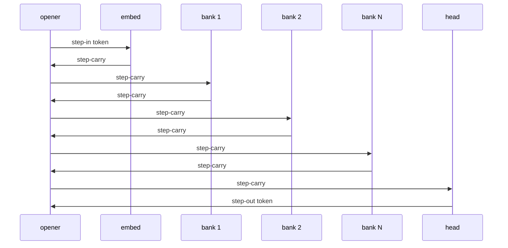

[nodo](index.md) · [Flow](flow.md) · [Network](network.md) · [Model](model.md) · **Session** · [Protocol](protocol.md)

# Session

A session is one generation request walking one complete composition. The **opener** is the process that read the prompt. A **holder** is any participant that owns a commitment in that composition, including the opener when it holds a role itself.

## Opening

`Participant.command` strips an optional `nodo ` prefix and calls `_ask` with the line as UTF-8 bytes.

`_ask`:

1. Abandons any current session (`session-close` to its holders).
2. Rejects an empty request (`open_allowed`).
3. Picks the first entry of `View.complete()` whose merged declaration is visible (`_pick`). None → `no model`.
4. Encodes with `bytes_vocab()`. Failure, or `len(prompt) + bound > span` → `no model`.
5. Allocates a session id (`uuid7`).
6. Sends `session-open` to every distinct holder (`_open_peers`). A missing association to a remote holder → `no model`.
7. Sends the first `step-in`.

A holder accepts `session-open` only if (`_hold_open`):

- `participant` is the hop (authorization)
- a matching complete composition exists
- the commitment list is identical
- this process is one of those holders
- no other non-suspended session with that id is already held

It then stores `{opener, declarant, capability, commitments, assoc, state: "open"}`.

## One token

Commitments are ordered embed → every accepted bank (holder-id order) → head. The walk is as long as the mesh: five banks means five `step-carry` hops before head.

If the opener holds a role, `_emit_step` applies locally instead of sending a record. A holder on another network is the same item, delivered TCP or `convey`.

`_apply_step` on a holder:

1. Session must exist and `opener == peer`.
2. `commitment` must be this process's row.
3. `(session, commitment, sequence)` must be unseen (replay → drop).
4. Carry length must equal `width` (512).
5. The local file must occupy (`occupy` → `Held` with a `reservation`-sized state buffer).
6. `apply_role` (`slice.apply`) returns `("carry", body)` or `("token", int)`.
7. Carry replies name the **next** commitment id. Token replies are `step-out`.

The opener's `_forward_carry` checks sequence, width, and that the named commitment is in the composition. Wrong width → `_incompatible` (see Suspend). It then either applies locally or sends the carry to that holder.

`_take_out`:

- Only the last commitment's holder may emit `step-out`.
- Token must be `< len(vocabulary.pieces)` (256).
- While `sequence < len(prompt) - 1`, the token is a prompt echo and is not appended to `generated`.
- After that, the token is appended.
- `session-progress` is sent with the current sequence.
- Stop if the new token is `EOS` or `len(generated) == bound`.
- Otherwise increment `sequence`, set `token` to the next prompt token or to the just-generated token, and `_step_in` again.

## Closing

`_close_session` sends `session-close`, drops the held row, and prints:

- UTF-8 decode of `generated` without a trailing EOS, or
- `incomplete` if there are no tokens, decode fails, or generation stopped short of both EOS and `bound`.

A new prompt from the same opener abandons the previous session first.

## Bank growth

On every successful bank apply, `append_bank` writes the current carry as a new `(key, value)` pair on **that** holder's file. Two machines therefore accumulate different banks. Later prompts attend against whatever each disk already stored. Nothing ships those pairs to the opener.

## Suspend and resume

The opener watches the view after every offer/declaration change (`_after_view`).

| situation | action |
| --- | --- |
| composition no longer complete | `session-suspend` cause `recomposition-incomplete` |
| carry width or token out of range | `_incompatible` → `result-incompatible` |
| composition complete again while suspended | `_resume`: forget the old held row, `_adopt` with `force`, `session-open` + `step-in` |
| opener process gone (holder) | session `closed`, `end` |
| a peer with an open session is lost (holder) | `recompose` |
| opener commitments change without suspend | `_adopt` if the commitment id set changed; re-open peers and `step-in` |

While `opened.suspended` is true, `_step_in` and `_forward_carry` refuse work.

## Holder table

`procedure.session_outcome` is the mechanical table in `domain.SESSION_TABLE`. States: `none`, `open`, `suspended`, `closed`. Selected transitions:

| state | event | next | action |
| --- | --- | --- | --- |
| `none` | `session-open` | `open` | accept |
| `none` | `step-in` / `step-carry` / `step-out` | `none` | reject |
| `open` | `step-in` / `step-carry` / `step-out` | `open` | accept |
| `open` | `step-in-repeat` | `open` | reject |
| `open` | `step-out-incompatible` | `open` | recompose |
| `open` | `session-suspend` | `suspended` | accept |
| `open` | `session-close` / `opener-loss` | `closed` | accept / end |
| `open` | `peer-loss` | `open` | recompose |
| `suspended` | `session-open` | `open` | accept |
| `suspended` | any `step-*` | `suspended` | reject |
| `closed` | any `step-*` / `session-open` | `closed` | reject |

Full tuples: [Protocol](protocol.md#session-table).

## Access mailbox

A second process that cannot take `member.lock` writes `state/access/<uuid>.cmd` and waits for `.done`. The member's serve loop (`_apply_access`) runs `command` on each `.cmd`. If a session is still open, the token is queued (`_mailbox`) and answered when generation finishes. stdout/stderr of that request become `.out` / `.err`.

[nodo](index.md) · [Flow](flow.md) · [Network](network.md) · [Model](model.md) · **Session** · [Protocol](protocol.md)
